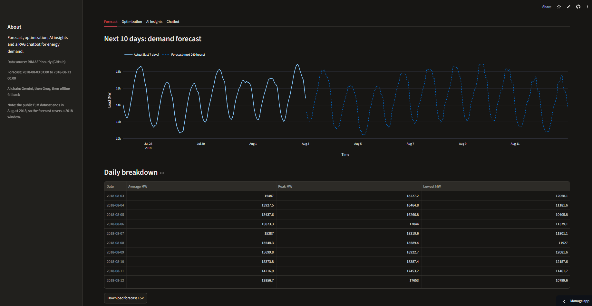
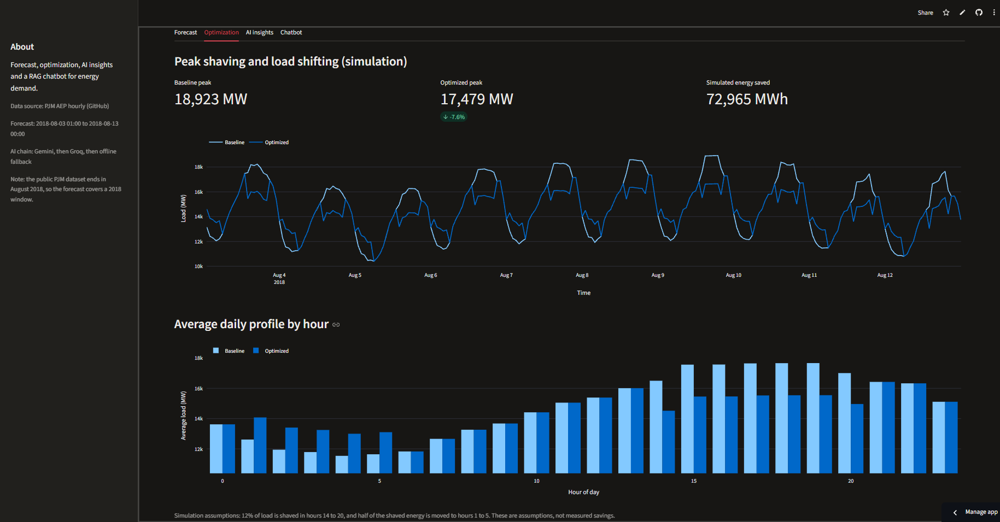
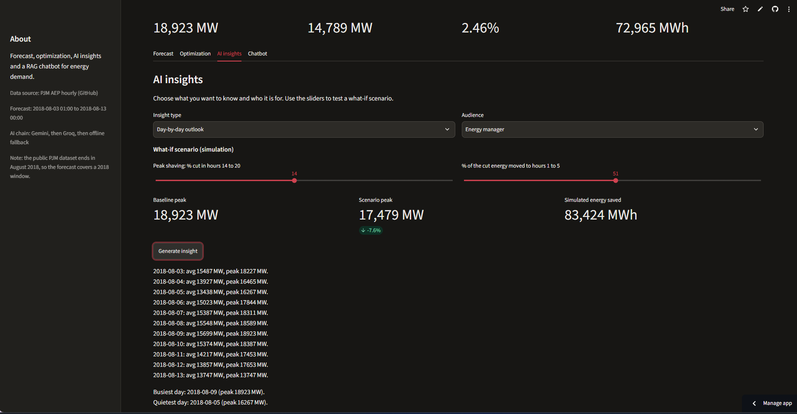
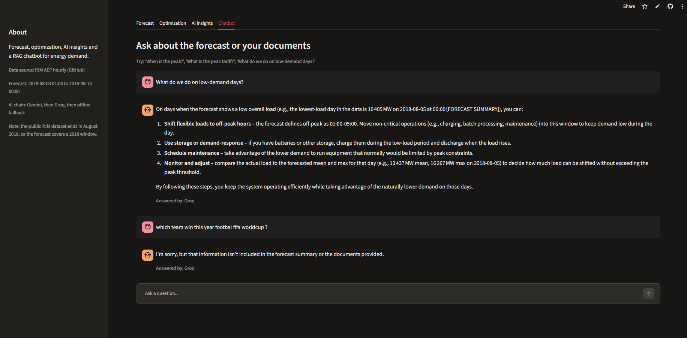

# Energy Optimization MVP

**Forecast electricity demand 10 days ahead, test peak-shaving ideas, and ask an AI chatbot about the results.**

**Live demo:** https://energy-optimization-mvp-csgebnzxbvoch6gthkytkd.streamlit.app/

(Hosted on a free plan, so it sleeps when nobody visits. If you see a "wake up" button, click it and wait a few seconds.)

### Highlights

- **Forecasting:** XGBoost predicts 240 hours (10 days) of hourly demand, with a 2.46% error (MAPE) on a 10-day holdout test.
- **What-if optimization:** simulates cutting load at peak hours and moving it to off-peak hours.
- **AI chatbot (RAG):** answers from the forecast and reference documents, and shows the sources it used.
- **Built to keep working:** if one AI service is busy or out of quota, the app switches to another, then to a plain summary.
- **Deployed:** a live Streamlit app, built from raw data to web page.

## What the app does

The app has four tabs:

- **Forecast:** shows the last 7 days of electricity use and predicts the next 10 days, hour by hour.
- **Optimization:** tests what happens if we use less electricity at the busiest hours and move some of it to early morning.
- **AI insights:** writes a short report from the numbers. You choose the report type and who it is for, and you can try your own what-if scenario with sliders.
- **Chatbot:** answer questions in your own words from the forecast and the reference documents, and shows the sources it used. A **Stop** button cancels a slow answer.

If one AI service is busy, the app switches to another instead of failing.

## Screenshots

| Forecast | Optimization |
|---|---|
|  |  |

| AI insights | Chatbot |
|---|---|
|  |  |

## The numbers

| What | Result |
|---|---|
| Forecast error (MAPE) on the last 10 days of data | 2.46% |
| Highest predicted load | 18,923 MW |
| Forecast window | 3 to 13 August 2018 |
| Hours predicted | 240 (10 days) |

MAPE is the average percentage the predictions are off by. Lower is better.

## How it works, in plain words

The project has three parts, and each part is one file:

1. **forecast_engine.py** learns from two years of hourly electricity data and predicts the next 240 hours. It predicts one hour, uses that prediction to help predict the next hour, and keeps going. It then saves the results as files.
2. **ai_rag_engine.py** is the AI part. When you ask a question, it first searches the reference documents for the most relevant passages. It then sends your question, the forecast summary and those passages to the AI, so the answer comes from real data and not from guesswork. This idea is called RAG (retrieval-augmented generation).
3. **app.py** is the web page you see, built with Streamlit and Plotly. It shows the charts, the optimization results, the AI report and the chatbot.

## The big picture

    PJM hourly data
          |
          v
    forecast_engine.py   (trains XGBoost, predicts 240 hours)
          |
          v
    data/ folder         (forecast CSV files and a summary file)
          |
          v
    ai_rag_engine.py     (document search + AI answers)  <--  docs/ folder (tariff and procedures)
          |
          v
    app.py               (dashboard: charts, AI report, chatbot)

The dashboard also reads the files in data/ directly to draw its charts.

## When the AI is busy

Since this project relies on free AI services, requests may occasionally fail due to quota limits or service availability. To address this, I implemented a fallback pipeline that automatically switches from Gemini to Groq, and if both are unavailable, the app generates a basic forecast summary with relevant document context instead of failing completely.

## Tools used

Python, Pandas, NumPy, XGBoost, scikit-learn, Plotly, Streamlit, Google Gemini, Groq.

## Files in this project

    app.py                the dashboard
    ai_rag_engine.py      AI reports, document search, backup plan
    forecast_engine.py    trains the model and makes the forecast
    requirements.txt      the Python libraries needed
    data/                 the forecast files the app reads
    docs/                 sample tariff and procedures for the chatbot
    screenshots/          pictures of the app

## Run it on your own computer

1. Install the libraries:

        pip install -r requirements.txt

2. Create the forecast files:

        python forecast_engine.py

3. Add your API keys in a file called .streamlit/secrets.toml:

        My_api_key = "your-gemini-key"
        Groq_api_key = "your-groq-key"

4. Start the app:

        streamlit run app.py

## Limitations & Error Analysis

I want to be clear about what this project is and is not:

- **The data is old.** The public PJM dataset ends in August 2018, so the demo forecasts a window in 2018. With a live data feed, the same code would predict the real next 10 days.
- **The savings are simulated.** The optimization uses fixed assumptions. The "energy saved" numbers are a what-if, not measured savings.
- **The accuracy score is a little optimistic.** The check on the last 10 days uses real past values inside that period, so the true 10-day error is probably higher than 2.46%.
- **The tariff and procedures are made up.** The documents in docs/ are samples for the demo.
- **Document search is basic.** It matches keywords and not meaning.
- **Free AI services have limits.** That is why the backup plan exists.

## What to do next

- Add weather and holiday information to improve the forecast.
- Test the forecast over many different periods, not just one.
- Use embeddings so document search understands meaning.
- Replace the simple peak-cutting rule with a real optimization using real tariffs.
- Save results in a database and retrain the model on a schedule.

## About me

Built by **Mahesh Rathod** as an end-to-end AI/ML portfolio project, covering the data, the model, the AI chatbot and the deployed app.

GitHub: https://github.com/Mahessh-rathod
